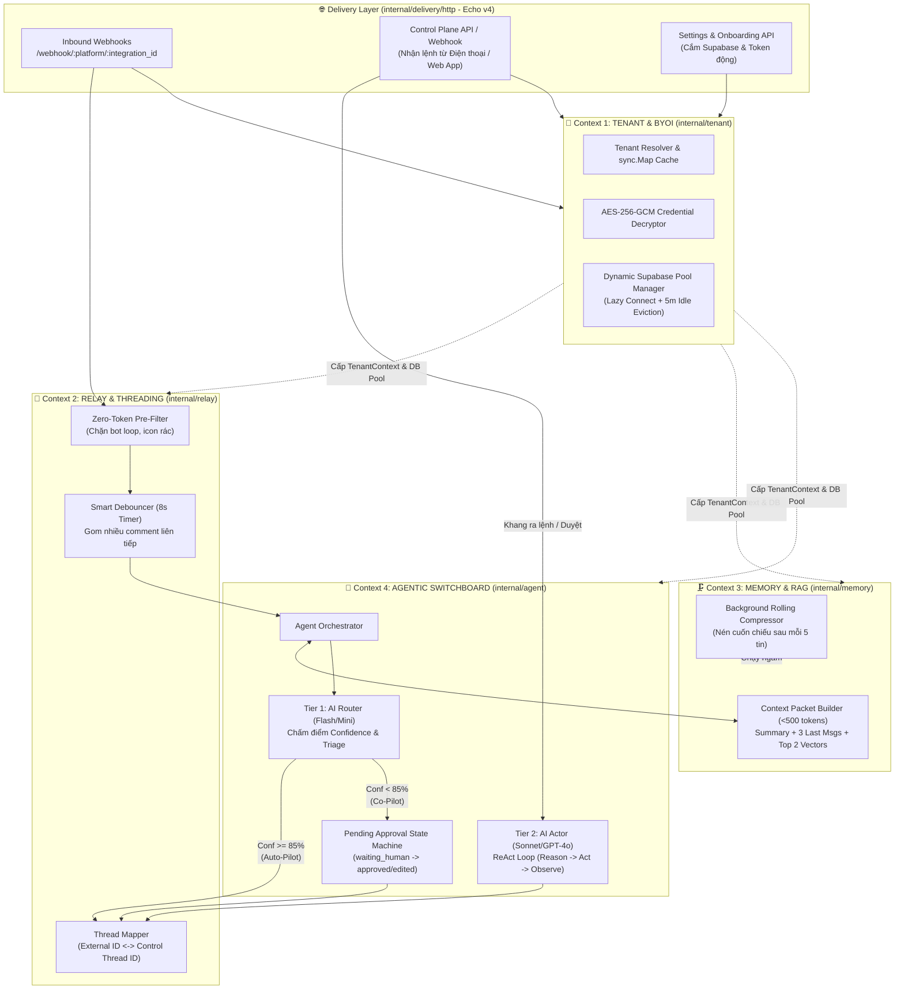
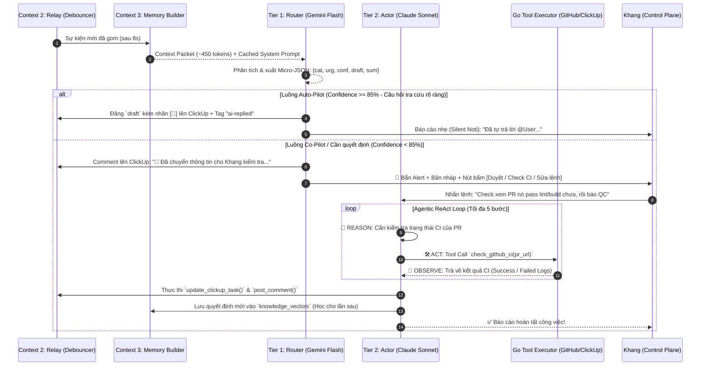
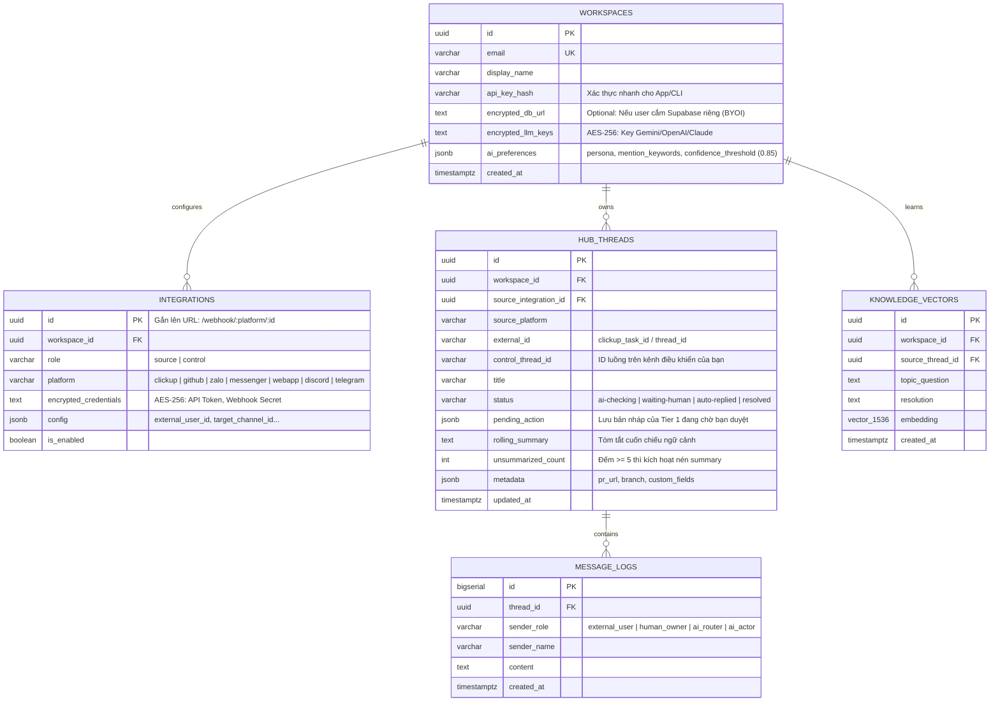

---
title: Nexus-Hub Master Architecture & MVP Specification
project: nexus-hub
version: 3.0.0-mvp
tags:
  - architecture
  - golang
  - ddd
  - bounded-contexts
  - ai-agent
  - hitl
status: mvp-locked
updated: 2026-10-26
---

# 🧠 Nexus-Hub: Personal AI Switchboard & Multi-Channel Agent

> [!abstract] Định vị Sản phẩm (The Master Concept)
> **`nexus-hub`** là một **Personal AI Switchboard (Trạm điều phối AI cá nhân)** đứng chắn giữa bạn và các kênh công việc ồn ào bên ngoài (ClickUp, GitHub, Zalo, Messenger).
> - **Công thức cốt lõi:** `Matterbridge` *(Multi-channel Go routing)* + `HumanLayer` *(HITL Pending State)* + `Executive AI` *(Auto-Triage & Persona)* + `Zep` *(Rolling Summary & pgvector)* + `BYOI` *(Bring Your Own Supabase)*.
> - **Hạ tầng mục tiêu:** Chạy mượt trên `Oracle VM.Standard.E2.1.Micro` (1/8 OCPU, 1GB RAM) với mức tiêu thụ **~20-25MB RAM** nhờ kiến trúc Stateless Go Binary (Echo v4 + `pgx` + `sqlc`).

---

## 1. Kiến trúc 4 Miền Ngữ Cảnh (4 Bounded Contexts - DDD)

Hệ thống được chia thành **4 Bounded Contexts độc lập** trong `internal/` để đảm bảo không bị phụ thuộc chéo (`import cycle`) và dễ dàng mở rộng:



---

## 2. Cơ chế hoạt động của Bộ não AI: Routing vs. Agentic Loop

Hệ thống kết hợp **Model Routing (Chọn AI theo độ khó)** và **Agentic ReAct Loop (Vòng lặp tự chủ gọi hàm Go)**:



---

## 3. Gia phả Kiến trúc (5 Open-Source Inspirations)

| Bounded Context trong `nexus-hub` | Kế thừa tinh hoa từ Repo | Cơ chế áp dụng vào Go |
| :--- | :--- | :--- |
| **`internal/relay`** | **`42wim/matterbridge`** & **`hatchet-dev`** | Chuẩn hóa mọi kênh về `NormalizedEvent`, ánh xạ `external_id <-> control_thread_id` và gom tin nhắn liên tiếp bằng `Debouncer` 8 giây. |
| **`internal/agent` (HITL)** | **`humanlayer/humanlayer`** | Máy trạng thái `PendingAction` (`waiting_human`): Dừng luồng chờ người thật duyệt hoặc gõ lệnh bổ sung từ điện thoại rồi mới thực thi tiếp. |
| **`internal/agent` (Triage)** | **`langchain-ai/executive-ai-assistant`** | Phân loại tín hiệu thành 3 nhóm (*Ignore / Auto-Reply / Escalate to Human*) và tự động trích xuất bài học từ câu trả lời của chủ nhân. |
| **`internal/memory`** | **`getzep/zep`** | Giữ chi phí token phẳng `O(1)` bằng cách nén mỗi 5 tin nhắn cũ thành `rolling_summary` + giữ 3 tin mới nhất + tra cứu `pgvector`. |

---

## 4. Thiết kế Database Schema cho MVP (`Supabase PostgreSQL + pgvector`)



---

## 5. Ánh xạ Cấu trúc Code 4 Bounded Contexts (`Directory Mapping`)

```text
nexus-hub/
├── cmd/server/main.go                      # Entrypoint: Khởi tạo DI cho 4 Contexts & Echo Server
├── internal/
│   ├── tenant/                             # [CONTEXT 1: TENANT & BYOI]
│   │   ├── domain.go                       # Struct Workspace, Integration, AIPreferences
│   │   ├── service.go                      # Load & cache cấu hình theo integration_id
│   │   ├── pool_manager.go                 # Quản lý pgxpool động (tự đóng sau 5p idle)
│   │   └── crypto.go                       # Mã hóa / Giải mã AES-256-GCM
│   │
│   ├── relay/                              # [CONTEXT 2: RELAY & DEBOUNCER]
│   │   ├── domain.go                       # NormalizedEvent, SourcePort, ControlPlanePort
│   │   ├── debouncer.go                    # Gom tin nhắn liên tiếp trong 8 giây
│   │   └── router_service.go               # Điều phối gửi/nhận giữa SourcePort và ControlPlanePort
│   │
│   ├── memory/                             # [CONTEXT 3: MEMORY & TOKENOMICS]
│   │   ├── domain.go                       # ContextPacket, KnowledgeChunk
│   │   ├── builder.go                      # Ghép Rolling Summary + 3 tin cuối + Vector RAG
│   │   └── compressor.go                   # Background goroutine tóm tắt cuốn chiếu mỗi 5 tin
│   │
│   ├── agent/                              # [CONTEXT 4: AGENTIC SWITCHBOARD]
│   │   ├── domain.go                       # TriageDecision, PendingApproval, ToolCall
│   │   ├── orchestrator.go                 # Nối Memory -> Tier 1 -> HITL / Tier 2 -> Relay
│   │   ├── tier1_router.go                 # Gọi model rẻ (Flash/Mini) xuất JSON siêu gọn
│   │   ├── tier2_actor.go                  # Vòng lặp for ReAct gọi Tools ( tối đa 5 bước)
│   │   ├── prompts.go                      # System Prompts hỗ trợ Prompt Caching
│   │   └── tools.go                        # Khai báo Schema & thực thi hàm (ClickUp, GitHub CI)
│   │
│   ├── adapters/                           # [INFRASTRUCTURE PLUGINS]
│   │   ├── sources/{clickup,github,zalo,messenger}/
│   │   ├── controls/{webapp,discord,telegram}/
│   │   ├── llm/client.go
│   │   └── storage/                        # Code do sqlc generate
│   │
│   └── delivery/http/                      # [ECHO v4 HANDLERS]
│       ├── router.go
│       ├── webhook_handler.go              # Nhận sự kiện từ ClickUp/Zalo/GitHub
│       ├── control_handler.go              # Nhận lệnh duyệt/reply từ Điện thoại của bạn
│       ├── settings_handler.go             # API cấu hình BYOI & Persona
│       └── middleware.go                   # Verify HMAC & Supabase JWT / API Key
├── db/
│   ├── embed.go                            # //go:embed migrations/*.sql (Auto-migrate BYOI)
│   ├── migrations/
│   └── query/hub_queries.sql
└── ARCHITECTURE.md
```

---

## 6. Lộ trình Đóng Gói MVP (MVP Execution Plan - 5 Milestones)

> [!todo] Chỉ tập trung làm đúng 5 bước này để ra bản MVP chạy thực tế đầu tiên (Chưa làm Zalo/Messenger vội, tập trung ClickUp + GitHub + 1 Kênh Control trước)
> - [ ] **Milestone 1: Core Domain & Smart Debouncer (`internal/relay` + `Echo`)**
>   - Định nghĩa `NormalizedEvent`, `SourcePort`, `ControlPlanePort` trong `internal/relay/domain.go`.
>   - Viết `debouncer.go` (gom tin nhắn trong 8s bằng `time.Timer` + `sync.Mutex`) và test qua endpoint `/webhook/:platform/:id` trên Echo.
> - [ ] **Milestone 2: Database Schema & Memory Builder (`db/` + `internal/memory`)**
>   - Viết `00001_init_mvp.sql` + `hub_queries.sql` và chạy `sqlc generate` vào `internal/adapters/storage`.
>   - Viết `internal/memory/builder.go` lấy `rolling_summary` + 3 tin nhắn gần nhất.
> - [ ] **Milestone 3: Tier-1 AI Router & ClickUp Adapter (`internal/agent` + `adapters/sources/clickup`)**
>   - Viết ClickUp Client: Verify HMAC, tự thả reaction `👀` (`Acknowledge`), đăng comment kèm nhãn `[🤖]` và gắn tag.
>   - Viết `tier1_router.go` gọi Gemini Flash trả về JSON `{cat, conf, draft, sum}` và rẽ nhánh `conf >= 0.85`.
> - [ ] **Milestone 4: Control Plane & HITL Loop (`adapters/controls` + `tier2_actor.go`)**
>   - Cắm 1 kênh điều khiển đầu tiên trên điện thoại (Web/Mobile API hoặc Discord/Telegram Topic).
>   - Viết vòng lặp `for` trong `tier2_actor.go` kèm 2 Tool: `check_github_ci` và `update_clickup_task` để khi bạn gõ lệnh trên điện thoại, AI tự đi kiểm tra PR và báo cáo lên ClickUp.
> - [ ] **Milestone 5: BYOI & Deploy lên Oracle `E2.1.Micro` (`internal/tenant` + `scripts/build_oracle.sh`)**
>   - Bật mã hóa `AES-256-GCM` cho API Token và `embed.FS` auto-migration.
>   - Cross-compile ra binary Linux AMD64 (~15MB) và chạy qua `systemd` + Cloudflare Tunnel trên VPS Oracle.